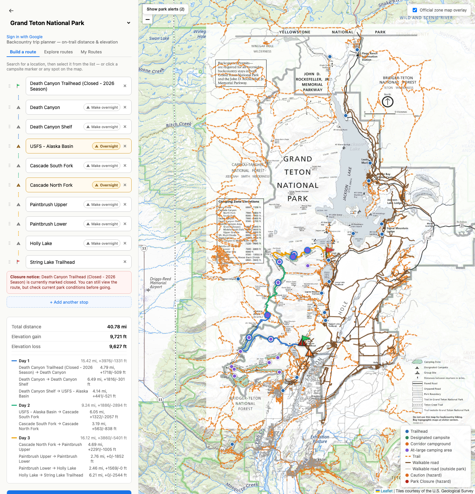
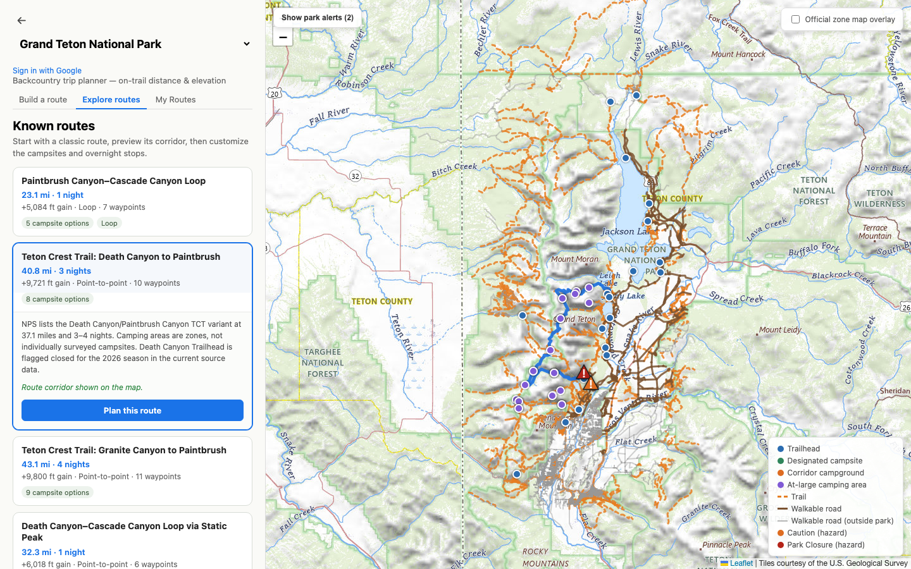
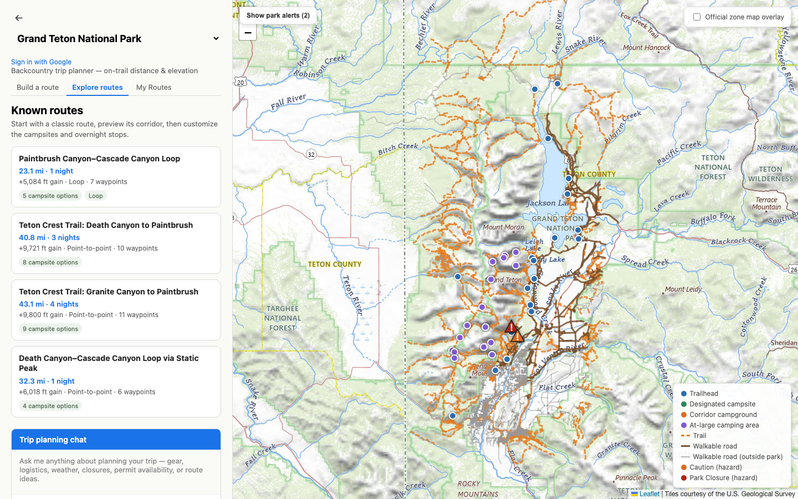

# Backcountry Trip Planner

Plan backpacking trips in U.S. national parks and forests with real on-trail numbers. Pick campsites (or any point on the map) and get the walking distance and elevation gain/loss between stops, not a straight-line guess.

The app lives in [`backcountry_planner/`](backcountry_planner/).

## What it does

- **On-trail routing.** Distance follows actual trails and roads, not as-the-crow-flies lines.
- **Elevation gain and loss.** Computed from USGS elevation data, with a filter that ignores sensor noise so a flat stretch doesn't read as a climb.
- **Campsites and any map point.** Click a permitted backcountry campsite or drop a pin anywhere on the map.
- **Multi-day trips.** Mark overnight stops and each day of the trek is colored and totaled separately.
- **Saved routes.** Sign in with Google to save and revisit trips.
- **Curated routes.** Browse known named routes and customize their campsites and stops.
- **AI trip assistant.** A chat agent that checks live weather, closures, and permit availability (see [below](#ai-trip-planning-assistant)).
- **Zone maps.** Scanned park zone maps can be overlaid on the map.

## Screenshots

**A planned 3-night route in Grand Teton.** Overnight stops split the trip into days, each drawn in its own color, with per-leg distance and elevation gain/loss and a closure warning.



**Explore curated routes.** Start from a classic named route, preview its corridor on the map, then customize campsites and overnight stops.



**Browse the park.** Trails, walkable roads, trailheads, campsites, an official zone map overlay, and live park alert pins.



## AI trip-planning assistant

Every park page has a **Trip planning chat** panel. It is not a generic chatbot: it is a tool-calling agent that looks things up before it answers, so questions about conditions, permits, and mileage get real data instead of guesses from training data. It knows which park you are in and what route you currently have on the map.

**What it can do**

| Ask it | It uses |
|---|---|
| "What's the weather at the trailhead this weekend?" | Live forecasts from the National Weather Service (api.weather.gov, no key needed) |
| "Are any trails closed?" | Official National Park Service alerts and road events (for NPS parks), or the park's conditions page as a fallback |
| "Is there a permit open for the first week of August?" | Recreation.gov's live availability, cached for 6 hours |
| "What's a good 3-night route here?" | The park's curated list of real named routes, with live mileage computed by the routing engine |
| "Can I do this in 4 nights at 10 miles a day?" | A deterministic itinerary solver that splits a corridor across nights using the same routing the map uses, so its numbers always match the app |

It also answers general gear, safety, and logistics questions conversationally, and shows small activity chips in the chat while it runs each lookup. Today's date is passed in, so "next weekend" resolves correctly.

**Setting it up**

The chat is optional. Without a key the rest of the app works normally and the chat returns a friendly error.

1. Get an Anthropic API key at https://console.anthropic.com/settings/keys.
2. Copy `backcountry_planner/backend/.env.example` to `backcountry_planner/backend/.env` and set:

   ```bash
   ANTHROPIC_API_KEY=sk-ant-...
   CHAT_MODEL=claude-haiku-4-5   # optional, this is the default
   CHAT_MAX_TOKENS=1024          # optional, max length of a reply
   NPS_API_KEY=                  # optional, enables official NPS closures and map hazard pins
   ```

3. Restart the backend (`npm run dev`) and open any park.

`NPS_API_KEY` is free from https://www.nps.gov/subjects/developer/get-started.htm. On Fly.io, set these with `fly secrets set` instead of a `.env` file.

**Choosing a model or provider**

Change `CHAT_MODEL` to swap Claude models with no code changes. A cheaper small model is the default because most questions are quick lookups. There is also an experimental Hugging Face path (`LLM_PROVIDER=huggingface`, plus `HF_TOKEN` and `HF_MODEL`). Both providers share the same tools, but Claude is noticeably more reliable at deciding when to call a tool, so Anthropic is the recommended default.

**Cost and safety notes**

- Chat history is kept in the browser only, never stored on the server, and the server trims it to the last 20 turns per request to cap cost.
- Replies are capped by `CHAT_MAX_TOKENS`.
- The assistant gives planning help, not guarantees. Confirm closures and permit rules with the managing agency.

If you also set `HF_TOKEN`, a small model is used to pin non-road NPS alerts to places on the map. Without it, those alerts appear in a "Park Alerts" list instead.

## Parks covered

Yellowstone, Grand Canyon, Mount Rainier, North Cascades, Zion, Sequoia & Kings Canyon, Joshua Tree, Sierra National Forest, Rocky Mountain, Grand Teton, Glacier, Olympic, Great Smoky Mountains, Canyonlands, and Yosemite.

## How it works

There is no external routing or elevation API at request time. Each park's data is downloaded once and read locally:

| Data | Source |
|---|---|
| Campsites, trailheads, closures | Recreation.gov permit API |
| Trails and roads | OpenStreetMap (via Overpass) |
| Elevation | USGS 3DEP |

A from-scratch graph engine snaps stops onto the trail network and runs Dijkstra's shortest path, then samples elevation along the route. Routing results were checked against Komoot (see [`backcountry_planner/testing/`](backcountry_planner/testing/)).

## Tech stack

- **Frontend:** React, Vite, TypeScript, Leaflet
- **Backend:** Node 20, Express, TypeScript, SQLite (better-sqlite3), Google OAuth
- **Deploy:** Docker on Fly.io

## Run it locally

Requires Node 20+.

```bash
cd backcountry_planner/backend && npm install
cd ../frontend && npm install
```

Copy `backend/.env.example` to `backend/.env` (all keys are optional for basic use; Google sign-in and chat need their credentials). Then run each server in its own terminal:

```bash
cd backcountry_planner/backend && npm run dev     # API on http://localhost:3001
cd backcountry_planner/frontend && npm run dev    # app on http://localhost:5173
```

Open http://localhost:5173.

### Elevation data

The large elevation rasters (`backend/data/<park>/dem/`) are not stored in git. Fetch them for a park with the script described in [`backend/scripts/README.md`](backcountry_planner/backend/scripts/README.md). Without them, the app falls back to live USGS point queries, which are slower.

## Documentation

| Doc | Covers |
|---|---|
| [`backcountry_planner/README.md`](backcountry_planner/README.md) | Setup, Docker, Fly.io deploy, Google OAuth |
| [`backcountry_planner/CLAUDE.md`](backcountry_planner/CLAUDE.md) | Architecture: routing and elevation engine, request flow, data layout |
| [`backcountry_planner/backend/scripts/README.md`](backcountry_planner/backend/scripts/README.md) | Adding a new park, elevation data pipeline |
| [`backcountry_planner/testing/README.md`](backcountry_planner/testing/README.md) | Accuracy validation and routing-gap diagnosis |

## Disclaimer

Distances and elevation numbers are estimates for planning only. Always check current conditions, closures, and permit rules with the managing agency before you go.
